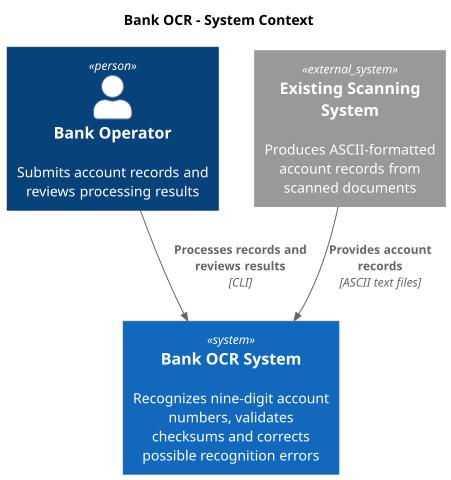

# 3. System Scope and Context

This chapter places Bank OCR in its environment: the external actors and systems it interacts with, the technical interfaces it uses, and a clear statement of what is inside and outside the system's scope. It is based on ADR-001 and the constraints recorded in Chapter 2, and is consistent with the goals in Chapter 1.

Bank OCR is a command-line tool with no network interfaces and no persistent storage (TC-3, TC-4, TC-5). Its entire context is local: a plain-text input file, a CLI invocation, and text output. There are no databases, brokers, APIs, or cloud services in the architecture (TC-5, TC-9).

## 3.1 Business Context

Bank OCR implements the Coding Dojo Bank OCR kata. In the kata's scenario, a bank has purchased a scanning machine that reads paper documents and emits a file of ASCII-formatted account records. Bank OCR is the downstream processor: it takes that file, recognizes the digits, validates the account numbers, and corrects what it can.

The system context has one human actor and one external system:

*Source: [`diagrams/c4-context.puml`](diagrams/c4-context.puml) — C4 Level 1 (System Context).*

| Element | Type | Description |
|---------|------|-------------|
| Bank Operator | Person (persona) | Submits account records and reviews processing results. Runs the Bank OCR CLI against an input file and reads the results. An illustrative persona for the kata, not a real production user (Chapter 1 stakeholders; OC-7). |
| Existing Scanning System | External system (`System_Ext`) | Produces ASCII-formatted account records from scanned documents. It is the source of Bank OCR's input. It is not built, owned, or modified by this project. |
| Bank OCR System | System (under design) | Recognizes nine-digit account numbers, validates checksums, and corrects possible recognition errors. The system whose architecture this document describes. |

Relationships (from the diagram):

- The Existing Scanning System **provides account records** to Bank OCR as ASCII text files.
- The Bank Operator **processes records and reviews results** through the CLI.

The business flow is strictly one-directional and batch-oriented: the scanning system produces a file once, the operator runs Bank OCR on that file, and Bank OCR emits the results. There is no ongoing conversation between Bank OCR and either actor during a run.

## 3.2 Technical Context

Bank OCR is a single-process Python 3.12 CLI (TC-1, TC-2, TC-3). All interaction is through the local filesystem and the command line. There is no network channel, no remote API, and no asynchronous messaging.

| Interface | Direction | Channel | Format / Protocol | Partner |
|-----------|-----------|---------|-------------------|---------|
| Account records | In | Local file, passed as a CLI argument | ASCII text. Each entry is 4 lines of 27 characters: three lines of nine 3×3 digit glyphs plus a blank line (K-1…K-4). A normal file holds around 500 entries. | Existing Scanning System |
| Results | Out | stdout, or a file via CLI redirect/flag | One result line per input record (K-16). A valid or successfully corrected number is printed as-is; an ambiguous record as `… AMB ['…', '…']`; an uncorrectable record as `… ILL` (FG-7). | Bank Operator |
| Control | In | Command line | Invocation and options (input file path, output target). | Bank Operator |

Notes on the interfaces:

- The input format is fixed by the kata (K-1…K-5); Bank OCR does not define it. The ten valid digit glyphs and the `?` placeholder for illegible digits are specified in Chapter 2.
- Output carries only the kata-defined status suffixes. Structural input errors (malformed or truncated files) are reported as input-format errors and are kept distinct from the kata's `ILL`/`ERR` record outcomes (QG-7).
- There are no other interfaces: no database, no message broker, no REST or RPC API, no cloud services (TC-4, TC-5, TC-9).

## 3.3 System Boundary and Scope

### 3.3.1 Inside the boundary (in scope)

The Bank OCR System boundary encloses a single Python CLI that owns five responsibilities, kept as distinct, testable modules (ADR-001; TC-6):

1. **Input Parser** — reads the input file and splits it into account records (FG-1; K-1…K-5).
2. **Digit Recognizer** — maps each 3×3 glyph to a digit 0–9, or `?` when no glyph matches (FG-2; K-5).
3. **Account Validator** — applies the mod-11 checksum and classifies records initially as valid / `ERR` / `ILL` (FG-3, FG-4; K-6…K-9).
4. **Error Corrector** — attempts single-segment correction on `ERR`/`ILL` records and resolves ambiguity (FG-5, FG-6; K-10…K-15).
5. **Report Generator** — writes one result line per record reflecting the final result after correction (FG-7; output format K-16…K-20).

Also in scope: deterministic processing (TC-11), robust handling of structural input errors (QG-7), and pytest unit tests for each module (TC-7).

### 3.3.2 Outside the boundary (out of scope)

The following are explicitly outside Bank OCR and are not introduced without a future accepted ADR:

- **Document scanning / physical OCR.** Producing the ASCII account records is the job of the Existing Scanning System. Bank OCR only consumes its text output; it never touches a scanner or an image.
- **Persistent storage.** No database, ORM, cache, or message broker (TC-5). State lives only for the duration of a single CLI run.
- **Graphical or web interface.** No GUI, web server, or REST/RPC API (TC-3). A web API is a noted future consideration of ADR-001, not part of this design.
- **Distribution.** No microservices, serverless functions, event brokers, or cloud infrastructure (TC-9). The system is one process, one deployment unit (TC-2).
- **Additional languages or runtimes.** Python 3.12 only (TC-1).
- **Production operation.** No production users, deployment, or service-level targets exist; this is a course kata (OC-7). Module 2 delivers the architecture documentation; the implementation is developed in later modules (OC-1).
