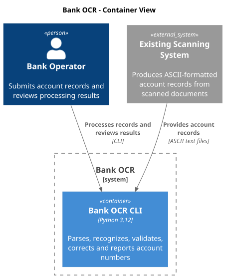
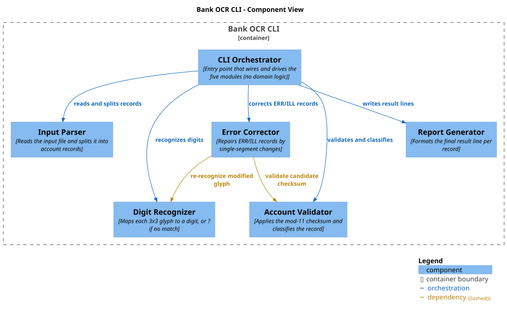

# 5. Building Block View

This chapter describes the internal structure of Bank OCR at two C4 levels: the deployable container (Level 2) and the components within it (Level 3). It is based on ADR-001 and the strategy in Chapter 4, and is consistent with the context in Chapter 3. The runtime is a single Python 3.12 process and a single deployment unit (TC-1, TC-2); there are no databases, APIs, microservices, or other infrastructure beyond ADR-001.

## 5.1 Overview

Bank OCR is one container — the **Bank OCR CLI** — containing five components, one per responsibility (ADR-001; TC-6):

| Component | Responsibility (summary) |
|-----------|---------------------------|
| Input Parser | Reads the input file and splits it into account records. |
| Digit Recognizer | Maps each 3×3 glyph to a digit, or `?`. |
| Account Validator | Applies the mod-11 checksum and classifies the record. |
| Error Corrector | Repairs `ERR`/`ILL` records by single-segment changes. |
| Report Generator | Formats the final result line per record. |

The components are modules within the single container, not separate deployable services (TC-2, TC-9). Each is independently unit-testable (QG-2; TC-7).

## 5.2 Container View (Level 2)

*Source: [`diagrams/c4-container.puml`](diagrams/c4-container.puml) — C4 Level 2 (Container).*

There is exactly one container inside the Bank OCR system boundary:

- **Bank OCR CLI** — a Python 3.12 command-line application that parses, recognizes, validates, corrects, and reports account numbers. It is the only deployable unit (ADR-001; TC-2).

The two external parties from Chapter 3 connect to this single container:

- The **Existing Scanning System** provides account records as ASCII text files (input).
- The **Bank Operator** drives the CLI and reviews results.

The container view matches the system context diagram: the system boundary still encloses only Bank OCR, but at this level the boundary contains one container rather than the system as a whole.

## 5.3 Component View (Level 3)

*Source: [`diagrams/c4-component-bank-ocr.puml`](diagrams/c4-component-bank-ocr.puml) — C4 Level 3 (Component).*

Inside the Bank OCR CLI container boundary are the five components and their data-flow relationships. Each subsection documents one module's responsibilities, inputs, outputs, dependencies, and boundary.

### 5.3.1 Input Parser

- **Responsibilities:** Read the plain-text input file (TC-4) and split it into account records. Each record is a four-line entry: three lines of 27 characters (the nine 3×3 digit glyphs) plus a blank line (K-3, K-4). Detect structural input errors — records whose first three lines are not exactly 27 characters each, whose fourth line is not blank, or files with missing or short lines (QG-7).
- **Inputs:** the input file path, provided by the CLI.
- **Outputs:** a sequence of records, each represented as nine 3×3 glyph cells, plus structural-error markers for malformed entries.
- **Dependencies:** none — it is the first stage of the pipeline and does not call other modules.
- **Boundary:** owns file reading and record splitting only; it does not recognize digits, validate checksums, correct, or format output.

### 5.3.2 Digit Recognizer

- **Responsibilities:** map each 3×3 glyph cell to one of the ten digits 0–9, or to `?` when the glyph matches none of the canonical set (K-5; FG-2).
- **Inputs:** a record's nine 3×3 glyph cells (from the Input Parser).
- **Outputs:** an account number string of nine characters, which may contain `?` for illegible digits.
- **Dependencies:** none as a pure function over the canonical glyph set; it does not call other modules. The Error Corrector reuses it to re-recognize modified glyphs (see §5.3.4).
- **Boundary:** owns the glyph-to-digit mapping; it does not read files, validate checksums, correct, or format output.

### 5.3.3 Account Validator

- **Responsibilities:** apply the kata's mod-11 checksum (K-6…K-8) and produce the initial classification (FG-4): valid, `ERR` (failing checksum), or `ILL` (contains `?`). Illegibility takes precedence over an invalid checksum, because a `?` cannot be checksummed.
- **Inputs:** an account number string (from the Digit Recognizer).
- **Outputs:** the initial classification (valid / `ERR` / `ILL`) and the checksum result.
- **Dependencies:** none as a pure function; the Error Corrector reuses it to validate candidate account numbers (see §5.3.4).
- **Boundary:** owns the checksum and initial classification; it does not correct records or format output.

### 5.3.4 Error Corrector

- **Responsibilities:** for records initially classified `ERR` or `ILL`, enumerate every single-segment change (add or remove one `|` or `_`) to each digit glyph, keep the candidates that yield a valid account number, and apply the kata's outcome rules (FG-5, FG-6; K-10…K-15): exactly one valid candidate → corrected number; more than one → `AMB` (sorted, single-quoted, bracketed list); none → `ILL`.
- **Inputs:** an `ERR` or `ILL` record — its nine glyph cells and the recognized account number.
- **Outputs:** the final result for the record (corrected number, `AMB` candidate list, or `ILL`).
- **Dependencies:** **Digit Recognizer** (to re-recognize a glyph after a segment change) and **Account Validator** (to check whether a candidate account number passes the checksum).
- **Boundary:** owns correction and the final outcome for `ERR`/`ILL` records; it does not read files, perform the initial classification, or format the output line.

### 5.3.5 Report Generator

- **Responsibilities:** format the final result as one output line per record (FG-7; K-16): a valid or corrected number is printed as-is; an ambiguous record as `… AMB ['…', '…']` (sorted ascending); an uncorrectable record as `… ILL` (with `?` placeholders for originally illegible records, readable digits for originally `ERR` records).
- **Inputs:** the final result per record — a valid account number from the Account Validator, or a correction outcome from the Error Corrector.
- **Outputs:** the result lines written to stdout (or an output file).
- **Dependencies:** none — it is a pure formatter; it receives results from the pipeline and does not call other modules.
- **Boundary:** owns output formatting; it does not recognize, validate, or correct.

## 5.4 Pipeline Coordination by the CLI

The CLI is the single entry point and the only orchestrator; it contains no domain logic (ADR-001; TC-3). It wires the five modules into a pipeline and drives it record by record:

1. Invoke the **Input Parser** to read the file and split it into records. Structural errors are reported as input-format errors and do not stop the run, so remaining records are still processed (QG-7).
2. For each record, invoke the **Digit Recognizer** to produce the account number string.
3. Invoke the **Account Validator** to classify the record (valid / `ERR` / `ILL`).
4. If the record is valid, pass the account number to the **Report Generator**.
5. If the record is `ERR` or `ILL`, invoke the **Error Corrector** — which reuses the Digit Recognizer and Account Validator to evaluate single-segment changes — then pass its correction outcome to the Report Generator.
6. The **Report Generator** writes the result line.

Because the modules are pure functions with clear inputs and outputs, the CLI can call each in isolation; this is what makes them independently unit-testable (QG-2; TC-7). The CLI itself is thin and holds no state between records, which keeps processing deterministic (TC-11).

## 5.5 Module Boundaries Summary

| Module | Responsibility | Input | Output | Depends on |
|--------|----------------|-------|--------|------------|
| Input Parser | read file, split into records, detect structural errors | input file path | sequence of records (9 glyph cells each) + error markers | — |
| Digit Recognizer | glyph → digit (or `?`) | record glyph cells | account number string | — (reused by Error Corrector) |
| Account Validator | mod-11 checksum + initial classification | account number string | classification (valid / `ERR` / `ILL`) | — (reused by Error Corrector) |
| Error Corrector | single-segment correction + outcome | `ERR`/`ILL` record | final result (corrected / `AMB` / `ILL`) | Digit Recognizer, Account Validator |
| Report Generator | format result line | final result per record | result lines (stdout / file) | — |
