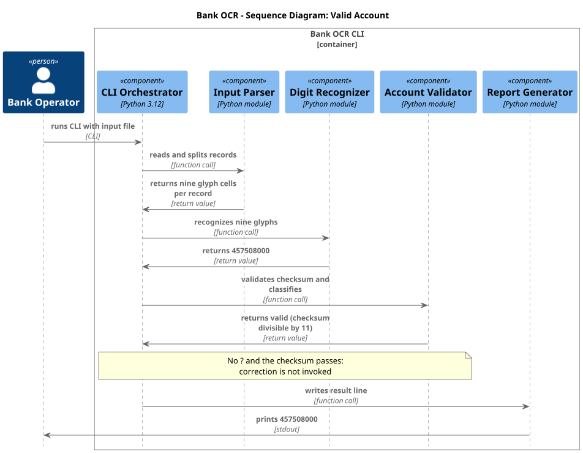
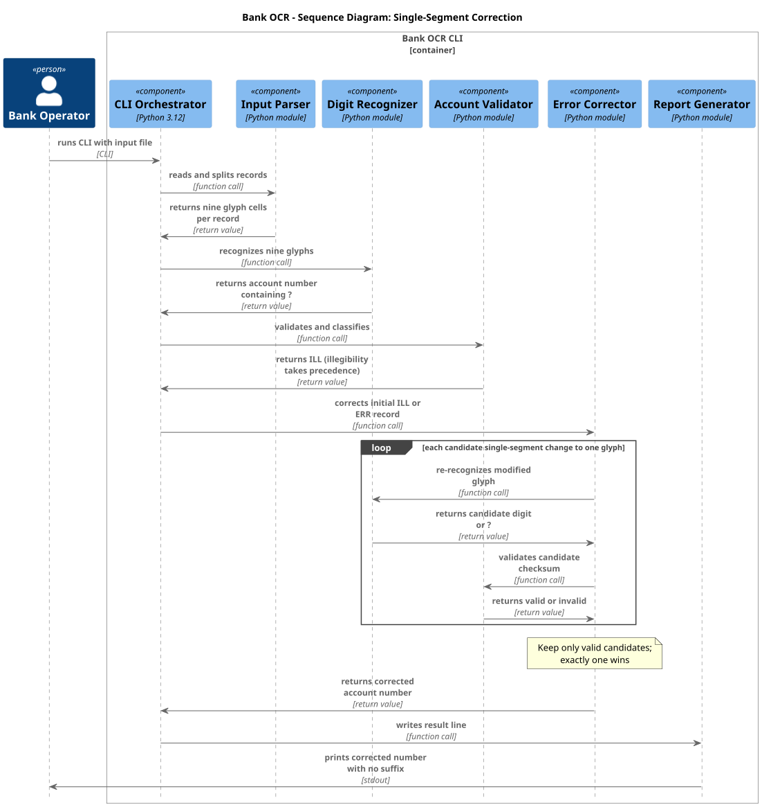
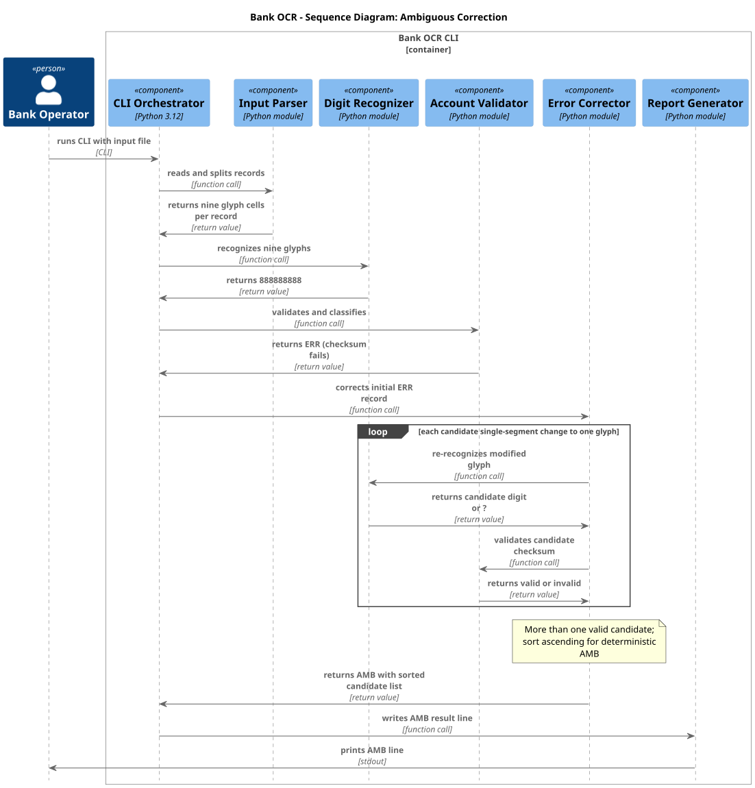
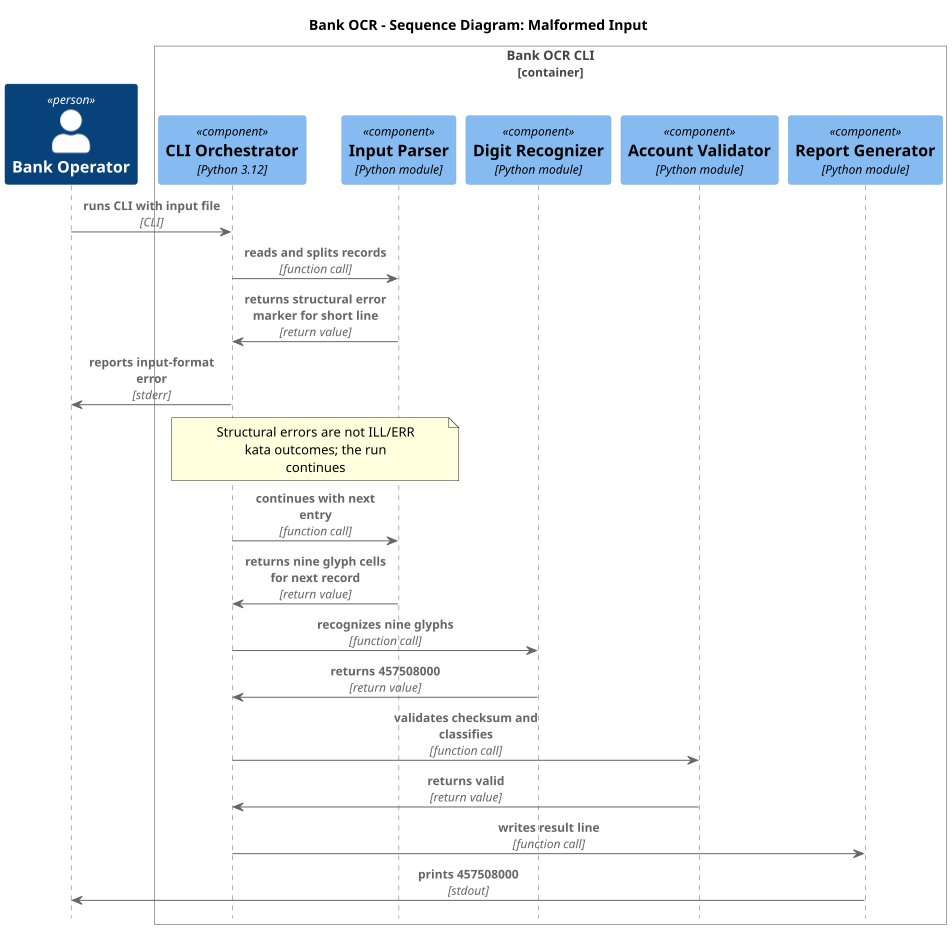

# 6. Runtime View

This chapter describes Bank OCR at runtime: which module is called, in what order, with which data, and with which result. It is derived from **ADR-001** and the approved Chapters 1–5; it introduces no new components, services, or infrastructure.

The runtime shape is stable across every scenario:

- One Python 3.12 process serves one CLI invocation over one plain-text input file (ADR-001; TC-1…TC-4). There is no database, broker, network call, or persistent state (TC-5, TC-9).
- The **CLI Orchestrator** is the only entry point. It wires and drives the pipeline and contains no domain logic (Chapter 5.4).
- The five business modules are **Input Parser**, **Digit Recognizer**, **Account Validator**, **Error Corrector**, and **Report Generator**. All calls between them are in-process Python function calls (Chapter 5.3; TC-2, TC-6).
- Only the **Error Corrector** calls other business modules: it reuses the Digit Recognizer and the Account Validator to evaluate candidate glyph changes (Chapter 5.3.4). No other module-to-module calls exist.
- Each module is a pure function over its inputs (TC-7); the orchestrator carries no state between records, which makes the pipeline deterministic (TC-11).

The diagrams below are C4 sequence diagrams at component level. Their participants use the names and descriptions from the approved component diagram in Chapter 5, plus the Bank Operator persona from Chapter 3. Relationships follow `Rel(from, to, 'label', 'technology')`; the technology is the runtime channel — `CLI`, `function call`, `return value`, `stdout`, or `stderr`. A `return value` arrow is data flowing back to the caller, not an additional participant.

## 6.1 Scenario 1: Successfully recognizing and validating an account number

**Trigger.** The operator runs the CLI on a well-formed input file. One entry renders the account number `457508000`, the valid example from the kata specification (Chapter 2, User Story 3).

*Source: [`diagrams/sequence-valid-account.puml`](diagrams/sequence-valid-account.puml).*

| Step | Interaction | Runtime effect |
|------|-------------|----------------|
| 1 | Operator → CLI Orchestrator (`CLI`) | The CLI invocation supplies the input file path. |
| 2 | CLI Orchestrator → Input Parser (`function call`) | The parser reads the file and splits it into four-line records of nine 3×3 glyph cells (FG-1; K-1…K-4). |
| 3 | Input Parser → CLI Orchestrator (`return value`) | One record's nine glyph cells are returned. |
| 4 | CLI Orchestrator → Digit Recognizer (`function call`) | Each glyph is matched exactly against the ten canonical patterns (FG-2; K-5). |
| 5 | Digit Recognizer → CLI Orchestrator (`return value`) | The account number string `457508000` — no `?`, because every glyph matched. |
| 6 | CLI Orchestrator → Account Validator (`function call`) | The mod-11 checksum is applied (FG-3; K-6…K-8). |
| 7 | Account Validator → CLI Orchestrator (`return value`) | Classification *valid*: the weighted sum is divisible by 11. |
| 8 | CLI Orchestrator → Report Generator (`function call`) | The final result is handed to the formatter. |
| 9 | Report Generator → Operator (`stdout`) | `457508000` is printed as-is, with no status suffix (FG-7; K-16, K-17). |

**Runtime notes.** Because the record contains no `?` and the checksum passes, its initial classification is already its final result: the **Error Corrector is not invoked** (FG-4, FG-5). The same path is taken for every valid record in the file; the orchestrator repeats steps 2–9 per record without retaining state from the previous one (Chapter 5.4). Output may be redirected to a file as described in Chapter 3.

## 6.2 Scenario 2: Illegible or invalid account and single-segment correction

**Trigger.** A record is initially classified `ILL` because at least one glyph matches no canonical digit (for example `86110??36`), or `ERR` because all nine digits are readable but the checksum fails. Illegibility takes precedence: a record with `?` is `ILL`, never `ERR` (FG-4; K-9). Both classifications follow the same correction path.

*Source: [`diagrams/sequence-correction.puml`](diagrams/sequence-correction.puml).*

| Step | Interaction | Runtime effect |
|------|-------------|----------------|
| 1 | Operator → CLI Orchestrator (`CLI`) | The CLI invocation supplies the input file path. |
| 2 | CLI Orchestrator → Input Parser → CLI Orchestrator | The record's nine glyph cells are parsed and returned. |
| 3 | CLI Orchestrator → Digit Recognizer → CLI Orchestrator | Recognition returns a string that contains `?` for the illegible case (or nine digits for the `ERR` case). |
| 4 | CLI Orchestrator → Account Validator → CLI Orchestrator | Initial classification is `ILL` (illegibility) or `ERR` (failing checksum). |
| 5 | CLI Orchestrator → Error Corrector (`function call`) | Only `ERR`/`ILL` records reach correction (FG-5; K-10). |
| 6 | Error Corrector → Digit Recognizer → Error Corrector (`loop`) | For every candidate change — adding or removing exactly one segment in one glyph — the modified glyph is re-recognized (Chapter 5.3.4). |
| 7 | Error Corrector → Account Validator → Error Corrector (`loop`) | Each resulting candidate account number is checked with the same mod-11 checksum. |
| 8 | Error Corrector → CLI Orchestrator (`return value`) | The correction outcome: exactly one valid candidate, several candidates, or none. |
| 9 | CLI Orchestrator → Report Generator → Operator (`stdout`) | The final line is formatted and printed. |

**Outcome rules applied at runtime** (FG-5, FG-7; K-11…K-13; shared with Scenario 3):

| Valid candidates found | Final result printed | Status suffix |
|------------------------|----------------------|---------------|
| Exactly one | The corrected nine-digit account number | None (K-11) |
| More than one | `AMB` with the sorted candidate list — see §6.3 | `AMB` (K-13, K-14) |
| None | The original digits, with `?` kept for an initially illegible record; readable digits for an initially `ERR` record | `ILL` (K-12) |

**Runtime notes.** The `loop` in the diagram is the exhaustive single-segment search inside the Error Corrector; it is not concurrency and not an external service. The Recognizer and Validator are reused unchanged, so a candidate is accepted only if a real glyph maps to a digit *and* the resulting account number passes the checksum. `ERR` is an initial classification only and never appears in final output; an uncorrectable `ERR` record ends as `ILL` (FG-7).

## 6.3 Scenario 3: Handling multiple valid correction candidates (AMB)

**Trigger.** An `ERR` record — the kata's `888888888` example, whose checksum fails — has more than one valid single-segment correction. The kata lists `888886888`, `888888880`, and `888888988` as valid candidates (Chapter 2, K-14).

*Source: [`diagrams/sequence-ambiguous.puml`](diagrams/sequence-ambiguous.puml).*

| Step | Interaction | Runtime effect |
|------|-------------|----------------|
| 1 | Operator → CLI Orchestrator (`CLI`) | The CLI invocation supplies the input file path. |
| 2 | CLI Orchestrator → Input Parser → CLI Orchestrator | The record's nine glyph cells are parsed and returned. |
| 3 | CLI Orchestrator → Digit Recognizer → CLI Orchestrator | Recognition returns `888888888`. |
| 4 | CLI Orchestrator → Account Validator → CLI Orchestrator | Initial classification is `ERR` (checksum fails). |
| 5 | CLI Orchestrator → Error Corrector (`function call`) | Correction is attempted, as in §6.2. |
| 6 | Error Corrector → Digit Recognizer / Account Validator (`loop`) | Every single-segment candidate is recognized and checksum-checked; several candidates pass. |
| 7 | Error Corrector sorts the candidates | All valid candidates are sorted in ascending order, so the result is reproducible (FG-6; K-15; QG-5, TC-11). |
| 8 | Error Corrector → CLI Orchestrator (`return value`) | An already-sorted `AMB` outcome carrying all valid candidate numbers. |
| 9 | CLI Orchestrator → Report Generator → Operator (`stdout`) | The Report Generator formats and prints `888888888 AMB ['888886888', '888888880', '888888988']` (K-14, K-20). |

**Runtime notes.** Ambiguity is resolved inside the Error Corrector, which owns the correction outcome (Chapter 5.3.4). The Report Generator only formats the already-sorted list; it does not re-validate or re-sort candidates (Chapter 5.3.5). No random choice is made and no candidate is discarded: all valid candidates are reported (QG-1, QG-5).

## 6.4 Scenario 4: Handling malformed input without crashing the application

**Trigger.** The input file contains a structurally malformed entry — a digit line that is not 27 characters wide, a non-blank fourth line, or a missing/short line (QG-7; Chapter 4.5). This is an input-format error, not a kata record outcome.

*Source: [`diagrams/sequence-malformed-input.puml`](diagrams/sequence-malformed-input.puml).*

| Step | Interaction | Runtime effect |
|------|-------------|----------------|
| 1 | Operator → CLI Orchestrator (`CLI`) | The CLI invocation supplies the input file path. |
| 2 | CLI Orchestrator → Input Parser (`function call`) | The parser reads and splits the file, validating each entry's four-line, 27-character structure (Chapter 5.3.1). |
| 3 | Input Parser → CLI Orchestrator (`return value`) | Instead of glyph cells, a structural-error marker is returned for the malformed entry. |
| 4 | CLI Orchestrator → Operator (`stderr`) | The input-format error is reported. The marker is **not** mapped to `ILL` or `ERR`, because those statuses are reserved for kata-defined records (QG-7). |
| 5 | CLI Orchestrator → Input Parser (`function call`) | Processing continues with the next entry; the bad entry does not abort the run (Chapter 5.4, QG-7). |
| 6 | Input Parser → CLI Orchestrator (`return value`) | Nine glyph cells are returned for the next, well-formed entry. |
| 7 | CLI Orchestrator → Digit Recognizer / Account Validator → CLI Orchestrator | The normal pipeline classifies the good record as valid. |
| 8 | CLI Orchestrator → Report Generator → Operator (`stdout`) | `457508000` is printed as the result line for that record. |

**Runtime notes.** The malformed entry never reaches the Digit Recognizer, Account Validator, Error Corrector, or Report Generator; it is isolated at the parsing stage. The CLI reports it directly on stderr, which keeps structural errors distinct from the kata result lines on stdout (Chapter 3.2, QG-7). The application completes the file without an unhandled exception; no exit-code behavior is defined by the kata. No new error-handling component is introduced — detection stays in the Input Parser and reporting stays in the thin orchestrator.

## 6.5 Cross-scenario runtime conventions

| Channel (diagram technology) | From → To | Meaning |
|------------------------------|-----------|---------|
| `CLI` | Bank Operator → CLI Orchestrator | A single process invocation with an input file path. |
| `function call` | CLI Orchestrator → business modules; Error Corrector → Digit Recognizer / Account Validator | In-process Python call; no IPC, network, or service boundary (TC-2). |
| `return value` | A module → its caller | Pure result passed back to the caller; modules hold no hidden state (TC-7). |
| `stdout` | Report Generator → Bank Operator | One final result line per well-formed input record (K-16, FG-7); may be redirected to a file. |
| `stderr` | CLI Orchestrator → Bank Operator | Structural input-format errors, kept distinct from kata statuses (QG-7). |

**Determinism and state.** Recognition, validation, and correction are deterministic; candidate lists are sorted before reporting, so identical input always produces identical output (QG-5; TC-11). State exists only within one record's processing and one CLI run — there is no cache, database, or message broker (TC-5, TC-9).

**Quality coverage.** These scenarios exercise QG-1 (exact kata statuses and output formats), QG-5 (deterministic correction and sorted `AMB` lists), QG-7 (structural errors separated from `ILL`/`ERR`/`AMB` outcomes and no unhandled crash), and QG-8 (single-pass processing of kata-scale input with no unnecessary I/O).

**Scope statement.** The only participants are the Bank Operator from Chapter 3 and the six elements inside the Bank OCR CLI container from Chapter 5. No service, database, broker, or additional component is introduced; the diagrams are a runtime projection of the approved component view, not a new architecture.
