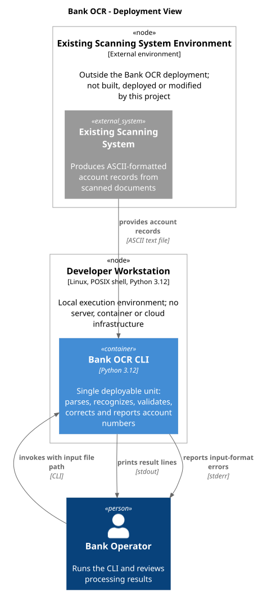

# 7. Deployment View

This chapter maps the approved architecture onto the environment where Bank OCR actually runs: a developer workstation. It is derived from **ADR-001** and the approved Chapters 1–6. There is no production deployment, no server, no container image, and no cloud infrastructure (OC-7; TC-9). Bank OCR is a course kata that runs locally, on demand, as one Python process.

## 7.1 Deployment Environment

| Element | Kind | Where it runs | Notes |
|---------|------|---------------|-------|
| Developer workstation | Deployment node | Local machine | POSIX shell under Linux; no specialized hardware is required (TC-10). |
| Python 3.12 interpreter | Runtime | Developer workstation | Executes the CLI in a single process; Python 3.12 only (TC-1). |
| Bank OCR CLI | Container / single deployable unit | Developer workstation | The whole application — all five business modules — deployed together (ADR-001; TC-2, TC-6). |
| Input file | Local text file | Workstation filesystem | Produced by the scanning system, passed to the CLI by path (Chapter 3.2). |
| Optional output file | Local text file | Workstation filesystem | Same text as stdout, via shell redirection or a CLI option (Chapter 3.2, Chapter 5.3.5). |
| Bank Operator | Person (persona) | Developer workstation | Invokes the CLI and reads its output; an illustrative kata persona, not a production user (Chapter 1, OC-7). |
| Existing Scanning System | External system | Outside our deployment | Produces the ASCII input file; not built, deployed, or modified by this project (Chapter 3.3.2). |

The workstation is the only deployment node owned by this project. Files are the only interface to the outside world: there is no listening socket, no database, no message broker, and no network service (TC-3…TC-5, TC-9). Nothing is installed or running between invocations — state exists only for the duration of one CLI run (Chapter 6.5).

## 7.2 Deployment Diagram



*Source: [`diagrams/c4-deployment.puml`](diagrams/c4-deployment.puml) — C4 Deployment View.*

The diagram is a deployment projection of the approved C4 context (Chapter 3) and container view (Chapter 5):

- The **Developer Workstation** node contains exactly one container, the **Bank OCR CLI**. This is the only software unit this project deploys.
- The **Existing Scanning System Environment** is shown as a separate node because that system is external: its output file crosses into our node, but its runtime is not ours to deploy.
- The **Bank Operator** invokes the CLI and receives result lines on stdout and input-format errors on stderr.
- The relation from the scanner to the CLI is a file hand-off, not a live connection: `ASCII text file`.

The five business modules (Input Parser, Digit Recognizer, Account Validator, Error Corrector, Report Generator) are modules *inside* this single deployed container, as shown in Chapter 5. They are not separately deployed, and no additional node represents them.

## 7.3 Deployable Unit and Startup

The deployable unit is the Python 3.12 CLI application itself — its modules and entry point — with no build, container image, web server, or installer step defined by the architecture (ADR-001; TC-2, TC-9). The exact module or script name of the entry point is an implementation detail; the architecture only fixes that a CLI is started from a POSIX shell with an input file path (TC-3; Chapter 3.2):

```text
python3 <cli-entry-point> <input-file>
```

An optional output target can be supplied by a CLI option or by shell redirection; no specific flag name is fixed by the approved chapters (Chapter 3.2).

Startup and processing follow the runtime view in Chapters 5.4 and 6:

1. The shell starts one Python process running the CLI Orchestrator.
2. The CLI Orchestrator calls the Input Parser, which reads the input file and splits it into four-line account records (FG-1; K-1…K-4).
3. For each record, the pipeline recognizes digits, classifies the record, invokes the Error Corrector for `ERR`/`ILL` records, and passes the final result to the Report Generator (Chapter 6.1–6.3).
4. Malformed entries produce an input-format error on stderr and are skipped without aborting the run (QG-7; Chapter 6.4).
5. Result lines are written to stdout, or to the optional output file, one per well-formed record (K-16; FG-7).
6. The process exits when the file has been processed. There is no daemon, scheduler, or long-running service.

Processing is single-pass and deterministic: identical input produces identical output, including sorted `AMB` candidate lists (QG-5, QG-8; TC-11).

## 7.4 Deployment Interfaces (Files and Streams)

| Channel | Direction | Format | Producer → Consumer | Deployment note |
|---------|-----------|--------|---------------------|-----------------|
| Input file | In | ASCII text; each entry is three 27-character glyph lines plus a blank line (K-1…K-4) | Existing Scanning System → Bank OCR CLI | Local path passed as a CLI argument; the file is not owned or modified by Bank OCR. |
| stdout | Out | One final result line per well-formed record (Chapter 6): number, `AMB` list, or `ILL` | Report Generator → Bank Operator | Default output channel; may be redirected to a file. |
| stderr | Out | Input-format error messages for structurally malformed entries (QG-7) | CLI Orchestrator → Bank Operator | Kept distinct from kata statuses; not an `ILL`/`ERR`/`AMB` record outcome. |
| Optional output file | Out | Same text as stdout | Report Generator → workstation filesystem | Via shell redirection or a CLI option; transient result text, not a persistent store (TC-4, TC-5). |
| Control | In | Command-line invocation and options (input file path, output target) | Bank Operator → CLI Orchestrator | No API, GUI, or network channel (TC-3). |

These files and streams are plain-text I/O, not persistence: no database, ORM, cache, or broker is deployed (TC-4, TC-5). No network port is opened, so there are no firewall, TLS, or service-discovery concerns in this deployment.

## 7.5 Runtime and Development Dependencies

| Dependency | Scope | Purpose | Justification |
|------------|-------|---------|---------------|
| Python 3.12 standard library | Runtime | Text and file handling, argument access, in-process function calls | Built into the chosen runtime; ADR-001 relies on Python's built-in text and file support. Minimal dependencies (TC-8). |
| Third-party runtime packages | Runtime | None at present | TC-8: a package is added only when it removes more complexity than it introduces, and only with an ADR. |
| pytest | Development / test only | Unit tests for each of the five modules in isolation | Required by ADR-001 and TC-7. It is not imported by the deployed CLI and is not needed to process input. |
| GitHub Actions | Planned CI, later course module | Automated test execution | OC-6: planned for a later CI/CD module, not part of ADR-001 and not a deployment unit. Will need its own ADR when adopted. |
| Docker, web server, database, broker, cloud SDK | Not used | — | No containerization, service, or infrastructure is justified by a local kata (ADR-001; TC-5, TC-9). |

The runtime dependency set is therefore just a Python 3.12 interpreter plus the application's own modules. Test dependencies live outside the deployed unit and do not change how the application is started.

## 7.6 External Scanning System vs. Bank OCR

| Aspect | Existing Scanning System | Bank OCR CLI |
|--------|--------------------------|--------------|
| Ownership | External; supplied by the kata scenario, not built or modified here (Chapter 3.3.2). | Built and owned by this project. |
| Deployment node | Its own environment, outside our node (diagram §7.2). | Developer workstation (Linux, POSIX shell, Python 3.12). |
| Artifact | Scanned documents → ASCII account records. | Python 3.12 CLI application, one deployable unit. |
| Role at runtime | Produces the input file once, before our run. | Reads that file and produces result lines. |
| Interface to the other party | Writes an ASCII text file. | Reads the file by path; never calls the scanner, never reads an image. |
| Failure handling | Outside our control. | Detects structural defects in its file via the Input Parser and reports them on stderr as input-format errors, not kata statuses (QG-7). |

The two systems communicate only through the file contract. There is no live session between them, no callback, and no shared database (Chapter 3.1). The scanner is not part of Bank OCR's deployment, and Bank OCR performs no physical scanning or image OCR (Chapter 3.3.2).

## 7.7 Constraint and Quality Trace

| Driver | How this deployment satisfies it |
|--------|----------------------------------|
| ADR-001; TC-1, TC-2 | One Python 3.12 application, one process, one deployment unit; no distributed runtime. |
| TC-3, TC-4 | POSIX-shell CLI with plain-text file I/O and stdout (TC-10 for Linux workstation). |
| TC-5, TC-9 | No database, broker, web server, serverless function, container, or cloud infrastructure. |
| TC-8 | Standard library only at runtime; any new dependency requires an ADR. |
| TC-7; OC-6 | pytest is development/test only; CI is deferred to a later module. |
| QG-4, QG-7, QG-8 | Minimal deployment footprint; structural errors isolated on stderr; single-pass batch processing for kata-scale files. |
| OC-7 | No production users, service levels, or operational deployment are assumed. |

**Scope statement.** This chapter introduces no new deployment unit, technology, or infrastructure. It describes where the already-approved CLI runs and the text channels it uses, consistent with Chapters 3–6 and ADR-001.
